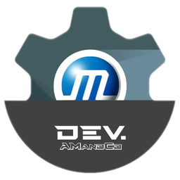

# rugen

A M.U.G.E.N-compatible 2D fighting game engine in Rust: your existing
characters and stages, unchanged, with rollback netplay.

## Download

Builds for Windows, Linux (`.rpm`, `.deb`, tarball) and macOS are on the
[releases page](https://github.com/rugen-dev/rugen-engine/releases). The
[install guide](https://rugen.dev/getting-started/install/) explains each one.

## Quick start

1. Drop fighters (`.zip`, `.rar`, folders or `.rgc`) into `chars/`.
2. Drop stages (`.zip`, `.rar`, folders or `.rgs`) into `stages/`.
3. Run `rugen`. New content is converted on launch, then the title screen opens.

```sh
rugen                 # the full game
rugen play kfm        # a quick match against the computer
```

## Features

- Loads M.U.G.E.N 1.1 / Ikemen GO content as it is (`.def` `.cns` `.cmd`
  `.air` `.sff` `.snd`), and packs it into compact `.rgc` / `.rgs` files.
- Arcade, VS (against a friend or the CPU, singles or teams), Arena (stocks,
  blast zones, platforms), challenge runs, and a PRACTICE page: Training
  with lessons built from each fighter's own moves, Watch and an in-game
  fighter debugger.
- Online play with rollback: rooms, quick match, ranked, spectators, peer to
  peer first with TURN and relay fallbacks.
- Bring your own character: players don't need the same fighters; the server
  judges each matchup and the files sync in the background.
- Every character is verified before its first match, so a broken one can't
  ruin a fight.
- Data-driven menus with two themes (Shonen Ink and Dojo), keyboard, gamepad
  and mouse.
- One codebase for Windows, Linux and macOS.

## Roadmap

### Done

- [x] **MUGEN content**: M.U.G.E.N 1.1 / Ikemen GO characters and stages load unchanged.
- [x] **`.rgc` / `.rgs` files**: content packed small, with lossless sprites and Opus sound.
- [x] **Arcade**: a ladder of CPU opponents.
- [x] **VS**: two players on one machine, or against the CPU.
- [x] **Training**: practice against a dummy, with lessons built from each fighter's own moves.
- [x] **Watch**: CPU against CPU.
- [x] **Arena**: stocks, blast zones and platforms.
- [x] **Arena HUD**: Smash-style fighter cards along the bottom.
- [x] **Rollback netplay**: online fights that stay smooth over distance.
- [x] **Rooms**: private or public, joined by a code with no lookalike characters.
- [x] **Quick match**: get paired with anyone online.
- [x] **Ranked**: rated matches with tiers and leaderboards.
- [x] **Spectators**: watch a room's match live.
- [x] **Flee**: leave an online match properly; it counts as a loss.
- [x] **Bring your own character**: players don't need the same fighters.
- [x] **Accounts**: optional username and password per server.
- [x] **Move list**: the pause menu reads each fighter's `.cmd`.
- [x] **Fighter size**: brings fighters drawn at very different scales together.
- [x] **Stage select**: a live preview and a strip built for hundreds of stages.
- [x] **Ink theme**: manga-print menus.
- [x] **Dojo theme**: a lacquer-and-washi training hall.
- [x] **Keyboard, gamepad and mouse**: with your own keys shown everywhere.
- [x] **Server backups**: daily copies to any S3-compatible bucket.
- [x] **One-way platforms**: jump up through them, double-tap down to drop.
- [x] **Arena AI**: CPU fighters stay on stage, recover and use platforms.
- [x] **Hitbox display**: see the attack and hurt boxes in Training.
- [x] **Frame data**: startup, active and recovery frames for every move.
- [x] **Input display**: the inputs of both players on screen.
- [x] **Record and playback dummy**: record a sequence and practise against it.
- [x] **Turns**: teams fight one after another, the winner stays in.
- [x] **Simul**: two against two, all on screen at once.
- [x] **Tag**: switch partners in the middle of a fight.
- [x] **Survival**: one life bar against an endless line of opponents.
- [x] **Boss Rush**: the toughest fighters back to back.
- [x] **Time Attack**: clear the ladder as fast as possible.
- [x] **Storyboards**: fighter intros and arcade endings.
- [x] **Ledge grab**: catch the edge of an arena and climb back on.
- [x] **Items**: pickups that spawn on arena stages, to grab and throw.
- [x] **Stage hazards**: moving platforms and stage events.
- [x] **User themes folder**: your own themes with live reload, no rebuild.
- [x] **Fighter debugger**: step through frames, states and variables.
- [x] **Steam Deck layout**: a handheld-friendly screen and controls, with bigger text.
- [x] **Ranked seasons**: ratings that soft-reset every 90 days; past seasons and tier badges stay.
- [x] **Per-fighter leaderboards**: the best players of each character, every season.
- [x] **Tournament brackets**: eight or sixteen players inside a room, seeded by rating.
- [x] **Live watching**: watch any online match from the lobby or a bracket, even mid-match.
- [x] **Shareable replays**: send a match to someone by code, kept 30 days.

### Planned

- [ ] **Translations (i18n)**: the menus in 10+ languages: Brazilian Portuguese, Spanish, French, Italian, German, Polish, Turkish, Indonesian, Filipino and Japanese.
- [ ] **Fighter library (SHARE)**: opt-in sharing of fighters you made or may share, with reports and takedowns; stored on Cloudflare R2.

## Build from source

Stable Rust 1.85+. Linux also needs the udev and ALSA headers (see
[BUILDING.md](BUILDING.md)).

```sh
cargo build --release
./target/release/rugen
```

## Documentation

Everything else lives on **[rugen.dev](https://rugen.dev)**:

- Playing: [install](https://rugen.dev/getting-started/install/),
  [first launch](https://rugen.dev/getting-started/first-launch/),
  [characters & stages](https://rugen.dev/getting-started/content/),
  [controls](https://rugen.dev/getting-started/controls/),
  [settings](https://rugen.dev/getting-started/settings/),
  [game modes](https://rugen.dev/playing/modes/),
  [online](https://rugen.dev/playing/online/),
  [CLI reference](https://rugen.dev/playing/cli/)
- Creating: [characters](https://rugen.dev/creating/characters/),
  [stages](https://rugen.dev/creating/stages/),
  [screenpacks & themes](https://rugen.dev/creating/screenpacks/)
- Hosting: [running a server](https://rugen.dev/server/overview/)
- Engine: [architecture](https://rugen.dev/engine/architecture/),
  [compatibility status](https://rugen.dev/engine/compatibility/),
  [building](https://rugen.dev/engine/building/),
  [contributing](https://rugen.dev/engine/contributing/)

## Related repositories

- [rugen-server](https://github.com/rugen-dev/rugen-server): the online hub
  (lobby, rooms, ranked, relay, matchups).
- [rugen-docs](https://github.com/rugen-dev/rugen-docs): the source of
  rugen.dev.

## Contributing

Read [CONTRIBUTING.md](CONTRIBUTING.md) (licence of contributions, commit
format, checks, no copyrighted content) and the
[contributing guide](https://rugen.dev/engine/contributing/), then
[DESIGN.md](DESIGN.md) for the architecture and the rules the code follows.
[BUILDING.md](BUILDING.md) has the system dependencies and the checks CI runs.

## License

MIT OR Apache-2.0 ([LICENSE-MIT](LICENSE-MIT),
[LICENSE-APACHE](LICENSE-APACHE)). Content under `reference/` keeps its own
licenses and is not committed.
